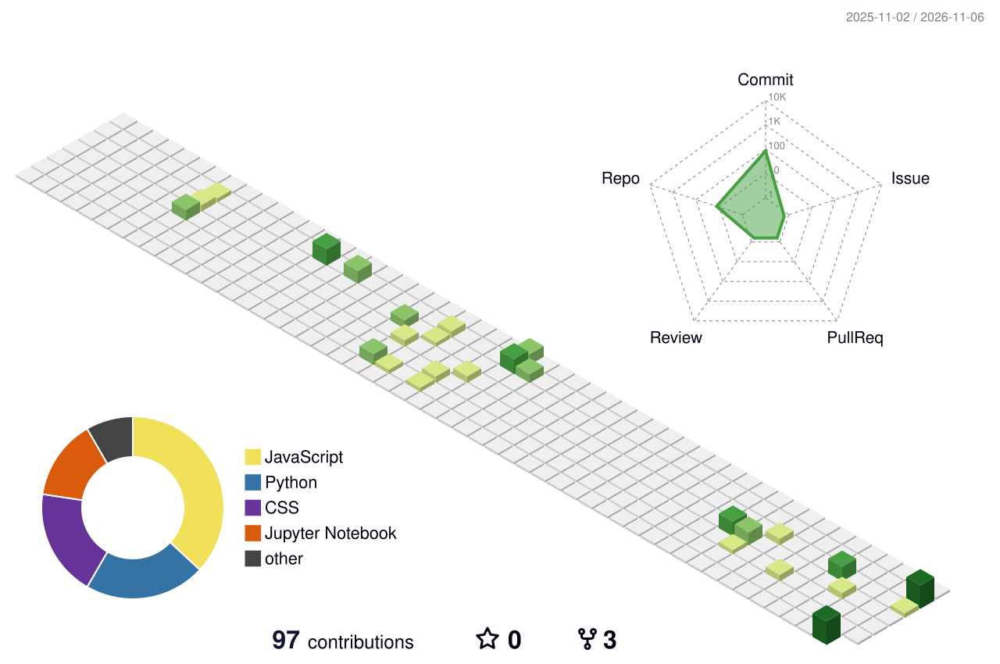

<!-- ================================================== -->
<!-- AYUSH PATEL | NEON FUTURISTIC PROFILE               -->
<!-- ================================================== -->

<!-- ANIMATED HEADER -->
<p align="center">
  
</p>

<!-- TYPING ANIMATION -->
<p align="center">
  
</p>

<!-- PROFILE BADGES -->
<p align="center">
  
  
  
</p>

---

## 👨‍💻 About Me

```python
class AyushPatel:

    def __init__(self):
        self.name = "Ayush Patel"
        self.education = "B.Tech CSE | CGPA: 7.34"
        self.roles = [
            "Python Backend Developer",
            "Data Analyst"
        ]

        self.backend = [
            "Python",
            "FastAPI",
            "Django",
            "REST APIs"
        ]

        self.data_analytics = [
            "Pandas",
            "NumPy",
            "Matplotlib",
            "Seaborn",
            "Excel",
            "Power BI"
        ]

        self.databases = [
            "PostgreSQL",
            "MySQL",
            "SQLite",
            "MongoDB"
        ]

        self.interests = [
            "Backend Architecture",
            "Data Visualization",
            "AI & RAG",
            "Problem Solving"
        ]

    def say_hi(self):
        return "Let's build something impactful!"
```

<p align="center">
  Computer Science graduate passionate about developing scalable backend
  applications and transforming data into meaningful insights.
  <br/><br/>
  I enjoy building REST APIs, working with relational databases,
  performing data analysis, and exploring AI-powered applications.
</p>

<p align="center">
  <a href="https://www.linkedin.com/in/ayushcodespy">
    
  </a>
  <a href="https://ayushcodespy01.vercel.app">
    
  </a>
  <a href="https://github.com/Ayushcodespy">
    
  </a>
</p>

---

## ⚡ Tech Arsenal

### Backend Development

<p align="center">
  
</p>

<p align="center">
  
  
  
</p>

### Data Analysis

<p align="center">
  
  
  
  
  
  
</p>

### Frontend & Tools

<p align="center">
  
</p>

### AI & Intelligent Applications

<p align="center">
  
  
  
  
</p>

---

## 🚀 Featured Projects

<table>
  <tr>
    <td width="50%" valign="top">

### 🤖 AI-Powered FAQ Chatbot

An AI-powered FAQ chatbot built to retrieve answers from service-related documents.

**Tech Stack**
- Python
- FastAPI
- React
- PostgreSQL
- FAISS
- RAG

**Key Features**
- Semantic search
- Document retrieval
- OCR-based document processing
- AI-powered question answering

    </td>
    <td width="50%" valign="top">

### 📊 Vendor Performance Analysis

A data analytics project focused on evaluating vendor performance and identifying business insights.

**Tech Stack**
- Python
- Pandas
- NumPy
- Matplotlib
- Seaborn

**Key Features**
- Data cleaning
- Exploratory data analysis
- Vendor performance evaluation
- Business insights

    </td>
  </tr>
  <tr>
    <td width="50%" valign="top">

### 🎁 IKEA Gifting Analysis

A data analysis project exploring gifting-related data and business trends.

**Tech Stack**
- Python
- Pandas
- Excel
- Data Visualization

**Key Features**
- Exploratory analysis
- Trend identification
- Business insights
- Data-driven decision making

    </td>
    <td width="50%" valign="top">

### 🛒 Grocery E-Commerce Platform

A full-stack grocery e-commerce platform with backend APIs and an admin dashboard.

**Tech Stack**
- FastAPI
- PostgreSQL
- SQLAlchemy
- React
- Flutter

**Key Features**
- REST API development
- Database integration
- Admin management
- Mobile application

    </td>
  </tr>
</table>

<p align="center">
  <a href="https://github.com/Ayushcodespy?tab=repositories">
    
  </a>
</p>

---

## 📈 GitHub Analytics

<p align="center">
  

  
</p>

<p align="center">
  
</p>

---

## 🌌 3D Contribution Graph

<p align="center">
  <picture>
    <source media="(prefers-color-scheme: dark)" srcset="https://raw.githubusercontent.com/Ayushcodespy/Ayushcodespy/main/profile-3d-contrib/profile-night-rainbow.svg"/>
    
  </picture>
</p>

---

## 🐍 Contribution Snake

<p align="center">
  
</p>

---

## 📚 Currently Learning

```text
Advanced Python
      ↓
FastAPI & Backend Architecture
      ↓
PostgreSQL & Database Design
      ↓
Data Analysis & Visualization
      ↓
AI / RAG Applications
```

---

## 🌐 Let's Connect

<p align="center">
  <a href="https://www.linkedin.com/in/ayushcodespy">
    
  </a>

  <a href="https://ayushcodespy.vercel.app">
    
  </a>
</p>

<p align="center">
  <b>Building. Learning. Improving.</b>
  <br/>
  <i>One commit at a time.</i>
</p>

<p align="center">
  
</p>
