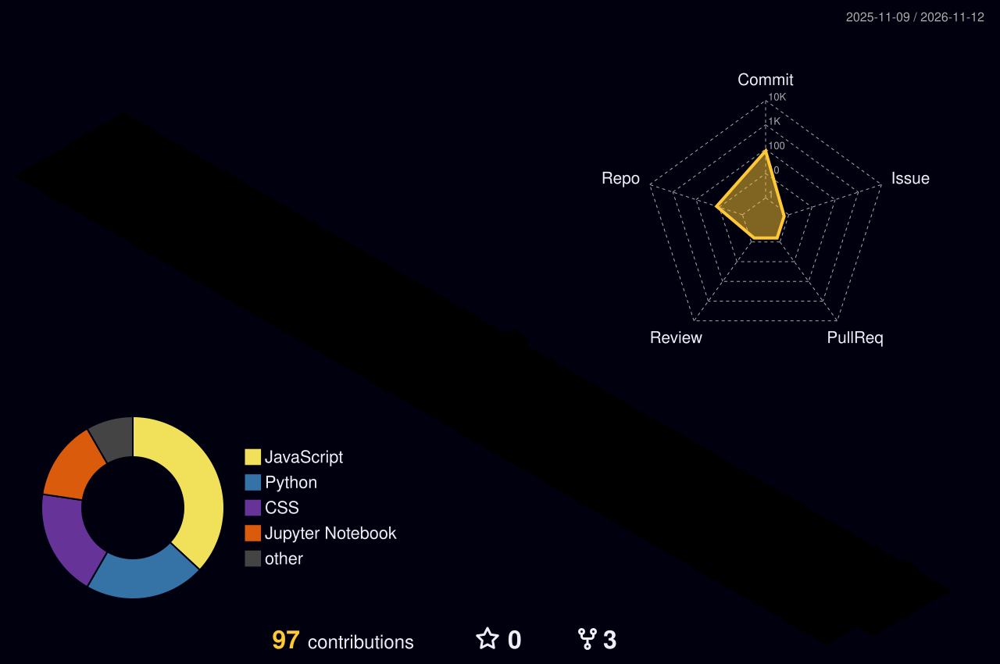

<!-- ====================================================== -->
<!-- AYUSH PATEL | NEON FUTURISTIC GITHUB PROFILE           -->
<!-- ====================================================== -->

<!-- ANIMATED HERO BACKGROUND -->

  

<!-- TYPING ANIMATION -->

  

<!-- PROFILE BADGES -->

  
  
  

<!-- SOCIAL LINKS -->

  
  
  

---

<!-- ABOUT ME -->
<h2 align="center">
  
</h2>

  

  <b>Hi, I'm Ayush Patel 👋</b>
   
  B.Tech Computer Science & Engineering Graduate
    
  I'm passionate about building scalable backend applications,
  developing REST APIs, and transforming raw data into meaningful insights.
    
  I enjoy working with Python, FastAPI, PostgreSQL, and Data Analytics
  while exploring AI-powered applications and intelligent solutions.

  
  
  
  

---

<!-- TECH STACK -->
<h2 align="center">⚡ TECH ARSENAL</h2>

<h3 align="center">💻 Backend Development</h3>

  

<h3 align="center">📊 Data Analysis</h3>

  
  
  
  
  
  

<h3 align="center">🌐 Frontend & Tools</h3>

  

<h3 align="center">🤖 AI & Intelligent Applications</h3>

  
  
  
  

---

<!-- FEATURED PROJECTS -->
<h2 align="center">🚀 FEATURED PROJECTS</h2>

  <i>Building practical applications and data-driven solutions.</i>

<table>
  <tr>
    <td width="50%" valign="top">

### 🤖 AI-Powered FAQ Chatbot

  
  

An intelligent FAQ chatbot that retrieves relevant information from documents and generates helpful answers.

**Tech Stack**

`Python` `FastAPI` `React` `PostgreSQL` `FAISS`

- Retrieval-Augmented Generation
- Semantic Search
- Document Processing
- OCR Integration

  

    </td>
    <td width="50%" valign="top">

### 📊 Vendor Performance Analysis

  
  

A data analysis project focused on evaluating vendor performance and discovering business insights.

**Tech Stack**

`Python` `Pandas` `NumPy` `Matplotlib` `Seaborn`

- Data Cleaning
- Exploratory Data Analysis
- Vendor Performance Evaluation
- Business Insights

  

    </td>
  </tr>
  <tr>
    <td width="50%" valign="top">

### 🎁 IKEA Gifting Analysis

  
  

An exploratory data analysis project focused on gifting-related data and business trends.

**Tech Stack**

`Python` `Pandas` `Excel` `Data Visualization`

- Exploratory Data Analysis
- Trend Identification
- Business Insights
- Data-Driven Decision Making

  

    </td>
    <td width="50%" valign="top">

### 🛒 Grocery E-Commerce Platform

  
  

A full-stack grocery e-commerce platform with backend APIs, database integration, and an admin dashboard.

**Tech Stack**

`FastAPI` `PostgreSQL` `SQLAlchemy` `React` `Flutter`

- REST API Development
- Database Integration
- Admin Dashboard
- Mobile Application

  

    </td>
  </tr>
</table>

  

---

<!-- GITHUB ANALYTICS -->
<h2 align="center">📈 GITHUB ANALYTICS</h2>

  
  

  

---

<!-- 3D CONTRIBUTION GRAPH -->
<h2 align="center">🌌 3D CONTRIBUTION GRAPH</h2>

  

---

<!-- CONTRIBUTION SNAKE -->
<h2 align="center">🐍 CONTRIBUTION ACTIVITY</h2>

  

---

<!-- CURRENTLY LEARNING -->
<h2 align="center">🎯 CURRENTLY LEARNING</h2>

  
  
  
  
  

---

<!-- CONNECT -->
<h2 align="center">🌐 LET'S CONNECT</h2>

  
  
  

  <b>BUILDING • LEARNING • IMPROVING</b>
   
  <i>One commit at a time.</i>

<!-- ANIMATED FOOTER -->

  

